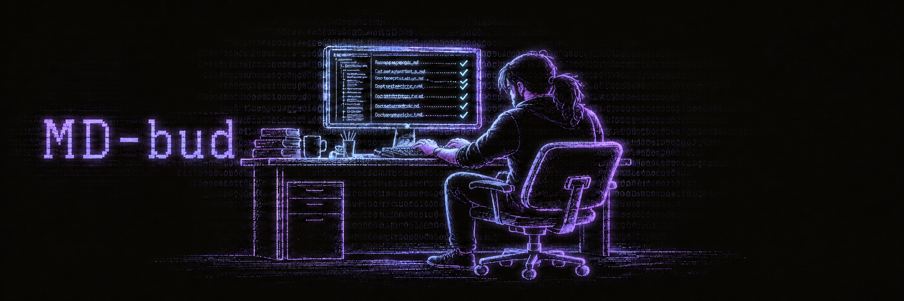
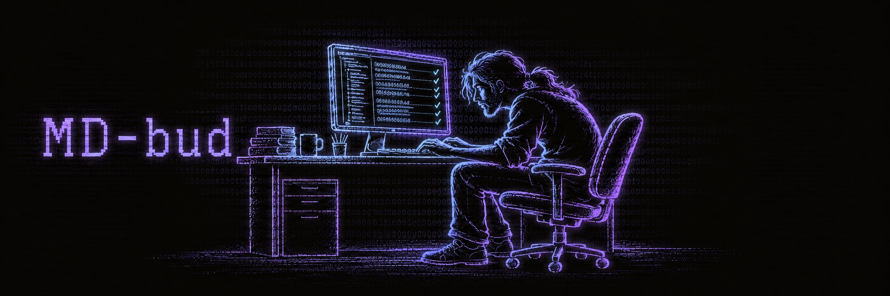
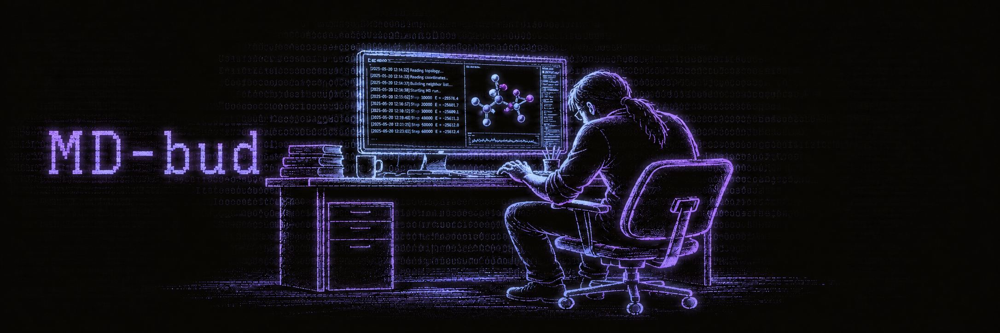
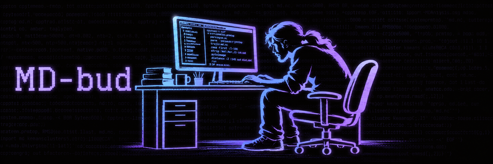

# MD-bud banner variations

Generated with the built-in image generator from the original [`banner.png`](../../banner.png).
The original banner remains in the main README. All versions retain its black,
purple and cyan terminal-art style and MD-bud lettering.

## 1. Faithful rear three-quarter view

## 2. Pronounced side-profile hunch

## 3. Molecular-dynamics workstation

The generation briefs are recorded in [PROMPTS.md](PROMPTS.md).
To select a version, change the main README image source to
`./assets/banner-variations/banner-ponytail-02.png` (or 01/03).

## 4. Bold silhouette and projected code

Restyled to match the user's new reference: broad smooth cyan/lavender shapes,
soft neon glow, simplified silhouettes and source-code texture.

